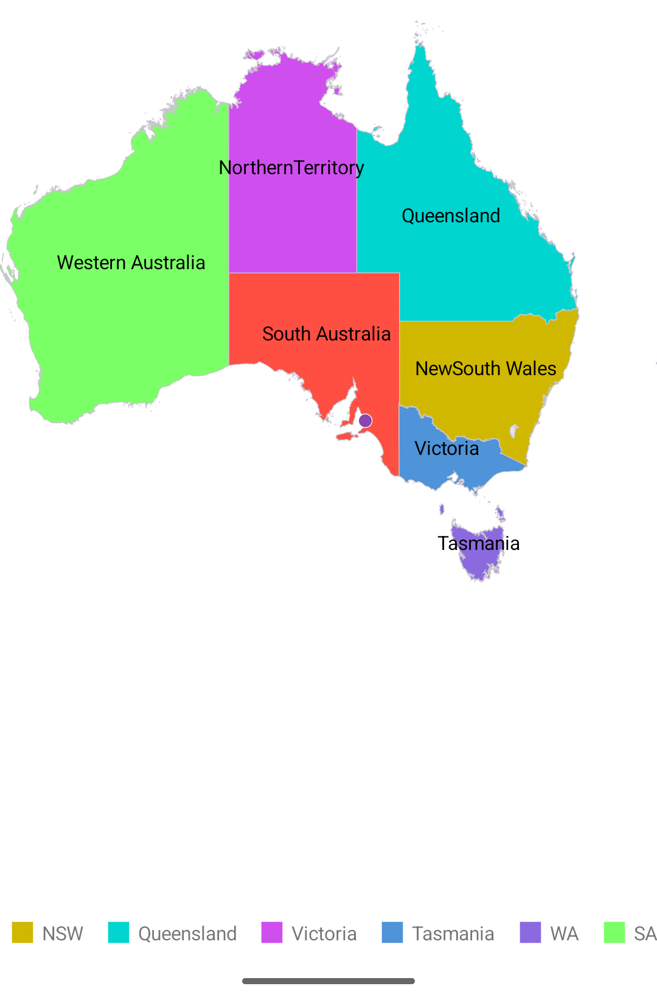

# GettingStarted_MAUI_Maps

## Creating an application using the .NET MAUI Maps

1. Create a new .NET MAUI application in Visual Studio.
2. Syncfusion .NET MAUI components are available in [nuget.org](https://www.nuget.org/). To add SfMaps to your project, open the NuGet package manager in Visual Studio, search for Syncfusion.Maui.Maps and then install it.
3. To initialize the control, import the Maps namespace.
4. Initialize [SfMaps](https://help.syncfusion.com/cr/maui/Syncfusion.Maui.Maps.SfMaps.html) with [MapShapeLayer](https://help.syncfusion.com/cr/maui/Syncfusion.Maui.Maps.MapShapeLayer.html).

###### Xaml
```xaml
<ContentPage xmlns="http://schemas.microsoft.com/dotnet/2021/maui"
             xmlns:x="http://schemas.microsoft.com/winfx/2009/xaml"
             xmlns:map="clr-namespace:Syncfusion.Maui.Maps;assembly=Syncfusion.Maui.Maps"
             x:Class="GettingStarted_MAUI_Maps.MainPage">

    <map:SfMaps>
        <map:SfMaps.Layer>
            <map:MapShapeLayer/>
        </map:SfMaps.Layer>
    </map:SfMaps>
</ContentPage>
```

###### C#
```C#
using Syncfusion.Maui.Maps;

namespace GettingStarted_MAUI_Maps;

public partial class MainPage : ContentPage
{
    public MainPage()
    {
        InitializeComponent();
    }
}   
```

## Register the handler

Syncfusion.Maui.Core nuget is a dependent package for all Syncfusion controls of .NET MAUI. In the MauiProgram.cs file, register the handler for Syncfusion core.

######
```C#
using Syncfusion.Maui.Core.Hosting;

namespace GettingStarted_MAUI_Maps;

public static class MauiProgram
{
    public static MauiApp CreateMauiApp()
    {
        var builder = MauiApp.CreateBuilder();
        builder
            .UseMauiApp<App>()
            .ConfigureSyncfusionCore()
            .ConfigureFonts(fonts =>
            {
                fonts.AddFont("OpenSans-Regular.ttf", "OpenSansRegular");
                fonts.AddFont("OpenSans-Semibold.ttf", "OpenSansSemibold");
            });

        return builder.Build();
    }
}
```

## Initialize view model

Now, let us define a simple data model that represents geographical data for the map.
###### C#
```C#
public class Model
{
    public string State { get; set; }
    public string StateCode { get; set; }
    public int ID { get; set; }

    public Model(string state, string stateCode, int id)
    {
        State = state;
        StateCode = stateCode;
        ID = id;
    }
}
```

Next, create a ViewModel class and initialize an ObservableCollection of `Model` objects with Australian states as follows.
###### 
```C#
using System.Collections.ObjectModel;

public class ViewModel
{
    public ObservableCollection<Model> Data { get; set; }
    public ViewModel()
    {
        Data = new ObservableCollection<Model>();
        Data.Add(new Model("New South Wales", "New\nSouth Wales", 1));
        Data.Add(new Model("Queensland", "Queensland", 2));
        Data.Add(new Model("Northern Territory", "Northern\nTerritory", 3));
        Data.Add(new Model("Victoria", "Victoria", 4));
        Data.Add(new Model("Tasmania", "Tasmania", 5));
        Data.Add(new Model("Western Australia", "Western Australia", 6));
        Data.Add(new Model("South Australia", "South Australia", 7));
    }
}
```

* Create a `ViewModel` instance and set it as the Grid's `BindingContext`. This enables property binding from `ViewModel` class.

* Add namespace of `ViewModel` class to your XAML Page, and set `BindingContext` in XAML.
###### Xaml
```xaml 
<Grid xmlns:local="clr-namespace:GettingStarted_MAUI_Maps">
    <Grid.BindingContext>
        <local:ViewModel/>
    </Grid.BindingContext>
</Grid>
```

## Add a shape layer with GeoJSON data

Adding a [MapShapeLayer](https://help.syncfusion.com/cr/maui/Syncfusion.Maui.Maps.MapShapeLayer.html) to the maps and setting the [ShapesSource](https://help.syncfusion.com/cr/maui/Syncfusion.Maui.Maps.MapShapeLayer.html#Syncfusion_Maui_Maps_MapShapeLayer_ShapesSource) property to load GeoJSON data to create a geographical map view.

* The maps has [Layer](https://help.syncfusion.com/cr/maui/Syncfusion.Maui.Maps.SfMaps.html#Syncfusion_Maui_Maps_SfMaps_Layer) as its default content.

* The [ShapesSource](https://help.syncfusion.com/cr/maui/Syncfusion.Maui.Maps.MapShapeLayer.html#Syncfusion_Maui_Maps_MapShapeLayer_ShapesSource) can be set from various sources like local file, Uri, or embedded resource.

* The [ShapeDataField](https://help.syncfusion.com/cr/maui/Syncfusion.Maui.Maps.MapShapeLayer.html#Syncfusion_Maui_Maps_MapShapeLayer_ShapeDataField) property identifies the field in the GeoJSON that contains the shape names.

* The [DataSource](https://help.syncfusion.com/cr/maui/Syncfusion.Maui.Maps.MapShapeLayer.html#Syncfusion_Maui_Maps_MapShapeLayer_DataSource) property binds the data from ViewModel.

* The [PrimaryValuePath](https://help.syncfusion.com/cr/maui/Syncfusion.Maui.Maps.MapShapeLayer.html#Syncfusion_Maui_Maps_MapShapeLayer_PrimaryValuePath) property maps the data to shapes based on the State field.

###### Xaml
```xaml
<map:SfMaps>
    <map:SfMaps.Layer>
        <map:MapShapeLayer x:Name="layer"
                           ShapeDataField="STATE_NAME"
                           DataSource="{Binding Data}"
                           PrimaryValuePath="State"
                           ShapeColorValuePath="ID"/>
    </map:SfMaps.Layer>
</map:SfMaps>
```
###### C#
```C#
public partial class MainPage : ContentPage
{
    public MainPage()
    {
        InitializeComponent();
        this.layer.ShapesSource = MapSource.FromResource("GettingStarted_MAUI_Maps.australia.json");
    }
}
```

## Display data labels

The [ShowDataLabels](https://help.syncfusion.com/cr/maui/Syncfusion.Maui.Maps.MapShapeLayer.html#Syncfusion_Maui_Maps_MapShapeLayer_ShowDataLabels) property enables data labels to display information about each shape. The [DataLabelSettings](https://help.syncfusion.com/cr/maui/Syncfusion.Maui.Maps.MapShapeLayer.html#Syncfusion_Maui_Maps_MapShapeLayer_DataLabelSettings) property customizes the label display using [DataLabelPath](https://help.syncfusion.com/cr/maui/Syncfusion.Maui.Maps.MapDataLabelSettings.html#Syncfusion_Maui_Maps_MapDataLabelSettings_DataLabelPath).

###### Xaml
```xaml
<map:MapShapeLayer ShowDataLabels="True">
    <map:MapShapeLayer.DataLabelSettings>
        <map:MapDataLabelSettings DataLabelPath="StateCode" />
    </map:MapShapeLayer.DataLabelSettings>
</map:MapShapeLayer>
```

## Add color mapping

The [ColorMappings](https://help.syncfusion.com/cr/maui/Syncfusion.Maui.Maps.MapShapeLayer.html#Syncfusion_Maui_Maps_MapShapeLayer_ColorMappings) property is used to apply different colors to map shapes based on values. The [EqualColorMapping](https://help.syncfusion.com/cr/maui/Syncfusion.Maui.Maps.EqualColorMapping.html) maps specific color values to corresponding data.

###### Xaml
```xaml
<map:MapShapeLayer.ColorMappings>
    <map:EqualColorMapping Color="#d0b800"
                           Value="1"
                           Text="NSW" />
    <map:EqualColorMapping Color="#00d5cf"
                           Value="2"
                           Text="Queensland" />
    <map:EqualColorMapping Color="#cf4eee"
                           Value="3"
                           Text="Victoria" />
    <map:EqualColorMapping Color="#4f93d8"
                           Value="4"
                           Text="Tasmania" />
</map:MapShapeLayer.ColorMappings>
```

## Add markers

The [MapMarker](https://help.syncfusion.com/cr/maui/Syncfusion.Maui.Maps.MapMarker.html) can be used to denote a specific location on the map with a custom symbol.

###### Xaml
```xaml
<map:MapShapeLayer.Markers>
    <map:MapMarkerCollection>
        <map:MapMarker x:Name="Adelaide"
                       Latitude="-34.928497"
                       Longitude="138.600739" />
    </map:MapMarkerCollection>
</map:MapShapeLayer.Markers>
```

## Enable tooltip

Tooltips are used to show information about a shape when hovering over it. Enable tooltip by setting the [ShowShapeTooltip](https://help.syncfusion.com/cr/maui/Syncfusion.Maui.Maps.MapShapeLayer.html#Syncfusion_Maui_Maps_MapShapeLayer_ShowShapeTooltip) property of [MapShapeLayer](https://help.syncfusion.com/cr/maui/Syncfusion.Maui.Maps.MapShapeLayer.html).

###### Xaml
```xaml
<map:MapShapeLayer ShowShapeTooltip="True"/>
```

## Enable a legend

The legend provides information about the map elements and their corresponding colors. Enable it by adding the [Legend](https://help.syncfusion.com/cr/maui/Syncfusion.Maui.Maps.MapShapeLayer.html#Syncfusion_Maui_Maps_MapShapeLayer_Legend) to the [MapShapeLayer](https://help.syncfusion.com/cr/maui/Syncfusion.Maui.Maps.MapShapeLayer.html). Set [SourceType](https://help.syncfusion.com/cr/maui/Syncfusion.Maui.Maps.MapLegend.html#Syncfusion_Maui_Maps_MapLegend_SourceType) to Shape and [Placement](https://help.syncfusion.com/cr/maui/Syncfusion.Maui.Maps.MapLegend.html#Syncfusion_Maui_Maps_MapLegend_Placement) to position it.

###### Xaml
```xaml
<map:MapShapeLayer.Legend>
    <map:MapLegend SourceType="Shape"
                   Placement="Bottom" />
</map:MapShapeLayer.Legend>
```

The following code example gives you the complete code of above configurations.
###### Xaml
```xaml
<ContentPage xmlns="http://schemas.microsoft.com/dotnet/2021/maui"
             xmlns:x="http://schemas.microsoft.com/winfx/2009/xaml"
             xmlns:map="clr-namespace:Syncfusion.Maui.Maps;assembly=Syncfusion.Maui.Maps"
             xmlns:local="clr-namespace:GettingStarted_MAUI_Maps"
             x:Class="GettingStarted_MAUI_Maps.MainPage">

    <Grid>
        <Grid.BindingContext>
            <local:ViewModel />
        </Grid.BindingContext>

        <map:SfMaps>
            <map:SfMaps.Layer>
                <map:MapShapeLayer x:Name="layer"
                                   ShapeDataField="STATE_NAME"
                                   DataSource="{Binding Data}"
                                   PrimaryValuePath="State"
                                   ShowDataLabels="True"
                                   ShowShapeTooltip="True"
                                   ShapeColorValuePath="ID">

                    <!--Set Data Label-->
                    <map:MapShapeLayer.DataLabelSettings>
                        <map:MapDataLabelSettings DataLabelPath="StateCode" />
                    </map:MapShapeLayer.DataLabelSettings>

                    <!--Set Color mapping-->
                    <map:MapShapeLayer.ColorMappings>
                        <map:EqualColorMapping Color="#d0b800"
                                               Value="1"
                                               Text="NSW" />
                        <map:EqualColorMapping Color="#00d5cf"
                                               Value="2"
                                               Text="Queensland" />
                        <map:EqualColorMapping Color="#cf4eee"
                                               Value="3"
                                               Text="Victoria" />
                        <map:EqualColorMapping Color="#4f93d8"
                                               Value="4"
                                               Text="Tasmania" />
                        <map:EqualColorMapping Color="#8b6adf"
                                               Value="5"
                                               Text="WA" />
                        <map:EqualColorMapping Color="#7bff67"
                                               Value="6"
                                               Text="SA" />
                        <map:EqualColorMapping Color="#ff4e42"
                                               Value="7"
                                               Text="NT" />
                    </map:MapShapeLayer.ColorMappings>

                    <!--Set Markers-->
                    <map:MapShapeLayer.Markers>
                        <map:MapMarkerCollection>
                            <map:MapMarker x:Name="Adelaide"
                                           Latitude="-34.928497"
                                           Longitude="138.600739" />
                        </map:MapMarkerCollection>
                    </map:MapShapeLayer.Markers>

                    <!--Set Legend-->
                    <map:MapShapeLayer.Legend>
                        <map:MapLegend SourceType="Shape"
                                       Placement="Bottom" />
                    </map:MapShapeLayer.Legend>
                </map:MapShapeLayer>
            </map:SfMaps.Layer>
        </map:SfMaps>
    </Grid>

</ContentPage>
```
###### C#
```C#
using Syncfusion.Maui.Maps;

namespace GettingStarted_MAUI_Maps;

public partial class MainPage : ContentPage
{
    public MainPage()
    {
        InitializeComponent();
        this.layer.ShapesSource = MapSource.FromResource("GettingStarted_MAUI_Maps.australia.json");
    }
}
```

###### ViewModel
```C#
using System.Collections.ObjectModel;

namespace GettingStarted_MAUI_Maps
{
    public class ViewModel
    {
        public ObservableCollection<Model> Data { get; set; }
        public ViewModel()
        {
            Data = new ObservableCollection<Model>();
            Data.Add(new Model("New South Wales", "New\nSouth Wales", 1));
            Data.Add(new Model("Queensland", "Queensland", 2));
            Data.Add(new Model("Northern Territory", "Northern\nTerritory", 3));
            Data.Add(new Model("Victoria", "Victoria", 4));
            Data.Add(new Model("Tasmania", "Tasmania", 5));
            Data.Add(new Model("Western Australia", "Western Australia", 6));
            Data.Add(new Model("South Australia", "South Australia", 7));
        }

        public class Model
        {
            public string State { get; set; }
            public string StateCode { get; set; }
            public int ID { get; set; }

            public Model(string state, string stateCode, int id)
            {
                State = state;
                StateCode = stateCode;
                ID = id;
            }
        }
    }
}
```

